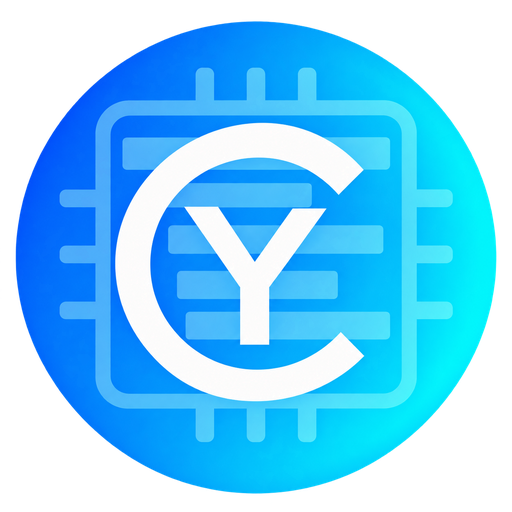
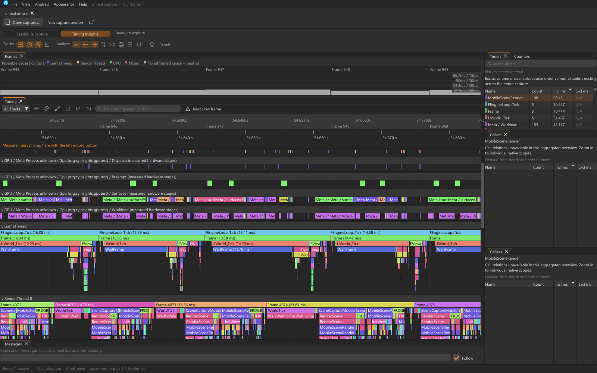
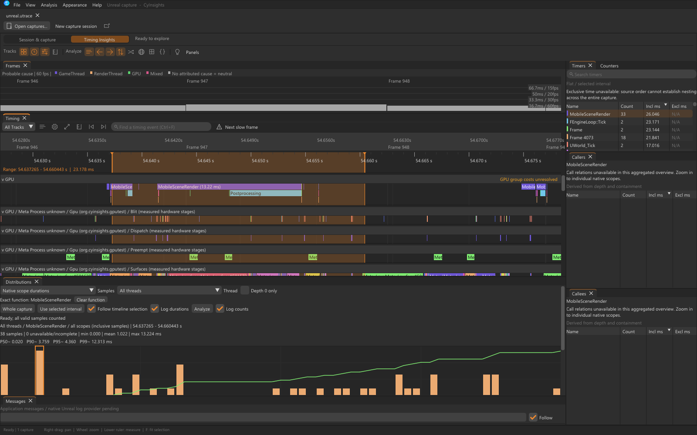
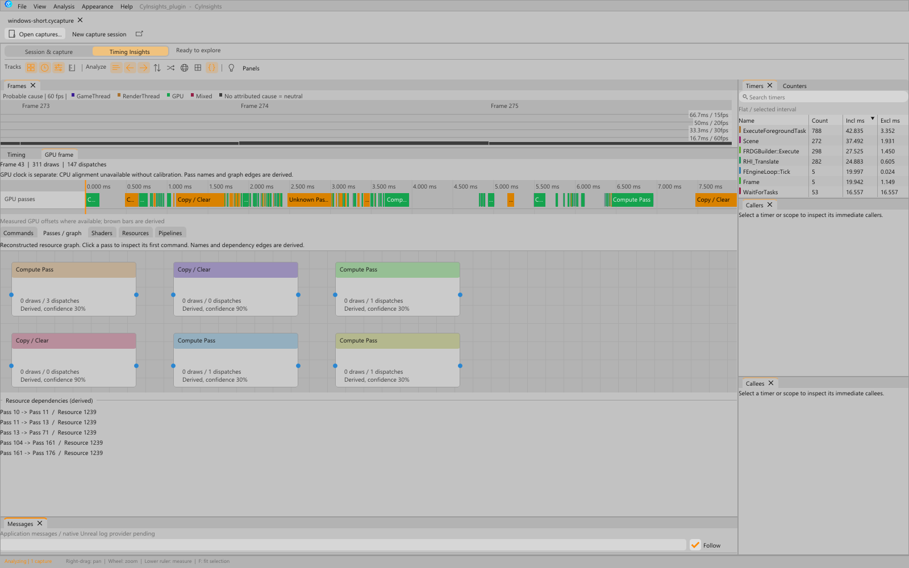

<table width="100%">
  <tr>
    <td width="300" align="left" valign="top">
      <a href="https://mrmybal.github.io/CyInsights/?lang=fr">Présentation</a><br>
      <a href="https://mrmybal.github.io/CyInsights/Documentation.html#/fr/welcome">Manuel</a><br>
      <a href="https://github.com/MrMybal/CyInsights">GitHub</a><br><br>
      <sub>README</sub><br>
      <a href="README.md">English</a> · <a href="README.fr.md">Français</a>
    </td>
    <td width="400" align="center" valign="middle">
      <a href="https://mrmybal.github.io/CyInsights/?lang=fr"></a>
    </td>
    <td width="300" align="right" valign="top">
      <p><sub>Licence de l’application</sub><br><a href="LICENSE"><strong>AGPL-3.0-or-later</strong></a></p>
      <p><sub>Version</sub><br><a href="Docs/Release-0.2.2-alpha.4.fr.md"><strong>0.2.2-alpha.4</strong></a><br><strong>ALPHA</strong></p>
      <p><a href="https://github.com/MrMybal/CyInsights/releases/tag/v0.2.2-alpha.4"><strong>Télécharger</strong></a><br><sub>Windows x64 · Quest arm64</sub></p>
    </td>
  </tr>
</table>

<h1 align="center">CyInsights</h1>

Un profileur natif pour les développeurs et artistes techniques sous Unreal
Engine. Explorez les traces CPU/GPU, les statistiques par frame et les activités
réseau, stockage et mémoire enregistrées sur une même timeline. L’application
autonome **CyInsightOVR** ajoute des métriques GPU dans le Quest et un profilage
optionnel des jeux de développement.

> **ALPHA · 0.2.2-alpha.4**
>
> Une version expérimentale destinée aux essais et aux retours ; certains lecteurs
> et parcours matériels restent incomplets. Consultez les
> [notes de version et limites documentées](Docs/Release-0.2.2-alpha.4.fr.md).

[](Docs/Images/cyinsights-timeline.png)

## À propos de CyInsights

Ouvrez un `.utrace` ou un `.cycapture`, repérez une frame lente et mesurez un
intervalle. Suivez les événements CPU/GPU imbriqués entre les threads,
double-cliquez sur une fonction pour filtrer son nom exact, ou ouvrez son
histogramme de durées depuis le menu contextuel. Timers, appelants/appelés,
compteurs, tâches et comparaisons A/B aident à préciser l’analyse. Plusieurs
traces peuvent rester ouvertes et être déplacées dans des fenêtres distinctes.

[](Docs/Images/cyinsights-function-histogram.png)

Le plugin Unreal optionnel enregistre des statistiques par frame configurables
et permet les captures de développement à distance. Les événements GPU natifs
d’Unreal constituent la première source de détail. Les captures Quest prises en
charge peuvent inclure les étapes matérielles GPU Meta ; le collecteur Windows
optionnel ajoute des commandes, ressources et timestamps GPU. Les mesures,
relations reconstruites et données indisponibles restent distinguées.

[](Docs/Images/cyinsights-gpu-passes.png)

CyInsightOVR s’exécute dans le casque et démarre son propre service GPU. Il propose
des courbes de compteurs système, des graphiques et valeurs de HUD configurables,
ainsi que des heatmaps de tuiles et compteurs de draw calls/triangles optionnels
pour les cibles Vulkan Development compatibles et préparées. Les overlays Vulkan
personnalisés ne fonctionnent pas universellement sur les jeux commerciaux non modifiés.

## Fonctionnalités

- **Analyse continue** : frames synchronisées, déplacement/zoom, règle de mesure
  d’intervalle, statistiques sur la sélection, distributions et plages A/B indépendantes.
- **Activités enregistrées** : compteurs Unreal, statistiques par frame, tâches,
  paquets réseau, opérations sur les fichiers, chargement et mémoire selon la capture.
- **Données GPU** : événements natifs, étapes matérielles Meta Quest optionnelles,
  relecture des tuiles/images et inspection optionnelle des commandes Windows.
- **Navigation réactive** : préparation en arrière-plan, index persistants sur disque,
  progression et annulation visibles ; cinq thèmes natifs et deux densités de contrôles.
- **Capture configurable** : réglages de base, groupes de statistiques et détail GPU
  optionnels ; lectures de textures/buffers désactivées par défaut. Les traces entrantes
  sont analysées après l’arrêt de l’enregistrement.
- **Analyse locale et intégration IA** : outils natifs d’AI Inspector et méthode
  d’analyse guidée, plus un compagnon MCP/SDK optionnel avec 39 opérations prises
  en charge. Les droits de contrôle et d’enregistrement sont distincts et désactivés initialement.
- **Manuel illustré hors ligne** : anglais et français, recherche, captures,
  schémas et références des API publiques. Utilisez **Help > User manual** / **F1**
  sur Windows ou **Help** dans CyInsightOVR. Le même lecteur CyDoc est disponible en ligne.
- **Mises à jour stables** : Windows et Quest recherchent les nouvelles versions
  stables sur GitHub. Les alphas s’installent manuellement.

---

## Installation

### Application Windows

1. Choisissez l’[installateur Windows (.exe)](https://github.com/MrMybal/CyInsights/releases/download/v0.2.2-alpha.4/CyInsights-v0.2.2-alpha.4-Windows-x64-Setup.exe)
   ou l’[édition portable (.zip)](https://github.com/MrMybal/CyInsights/releases/download/v0.2.2-alpha.4/CyInsights-v0.2.2-alpha.4-Windows-x64-Portable.zip).
2. Lancez Setup pour une installation utilisateur avec des raccourcis dans le
   menu Démarrer, ou extrayez **toute l’archive portable** et lancez
   `CyInsightsApp.exe`. L’édition portable conserve ses réglages, disposition,
   journaux et caches dans son dossier `Data/` adjacent. Gardez la documentation
   complète, les outils et les notices de licence.
3. Utilisez **Open capture**. Pour analyser un `.utrace`, ajoutez votre installation
   Unreal licenciée dans **Session > Native analyzer > Add engine** avec son dossier racine.

Les lecteurs natifs de timings/tâches/activités se préparent automatiquement en
arrière-plan et restent en cache par moteur. Cette préparation nécessite un
UE 5.5–5.8 compatible et licencié ainsi que les outils C++/CMake Visual Studio ;
UE 5.8 nécessite MSVC 14.44. Elle compile nos adaptateurs, sans recompiler Unreal.
Le pont CSV des timings reste disponible si la préparation native ne peut pas
aboutir. Aucun binaire Unreal n’est livré. Consultez le
[guide de premier lancement et de packaging](Docs/GitHubRelease.md).

Les [empreintes des éditions Windows](https://github.com/MrMybal/CyInsights/releases/download/v0.2.2-alpha.4/SHA256SUMS-Windows-Editions.txt)
couvrent l’installateur et le portable ajoutés à cette alpha. Le commit source
exact figure dans leurs manifestes et dans les notes de release publiées.

La version publiée de l’application de bureau cible **Windows x64**. Aucun paquet
de bureau Linux/macOS n’est fourni.

### Quest : CyInsightOVR

1. Installez **un seul** APK Android arm64 :
   [Standard](https://github.com/MrMybal/CyInsights/releases/download/v0.2.2-alpha.4/CyInsights-v0.2.2-alpha.4-Quest-Standard-arm64.apk)
   ou [Vulkan — heatmap et compteurs de draw calls expérimentaux](https://github.com/MrMybal/CyInsights/releases/download/v0.2.2-alpha.4/CyInsights-v0.2.2-alpha.4-Quest-Vulkan-arm64.apk).
2. Ouvrez **CyInsightOVR** depuis la bibliothèque du Quest / **Sources inconnues**.
   Son service GPU démarre depuis l’application, y compris après un redémarrage du casque.
3. Configurez les métriques et **Display & HUD**. Les commandes du HUD Meta et les
   couches Vulkan externes nécessitent une autorisation développeur accordée une fois ;
   le [paquet Quest complet](https://github.com/MrMybal/CyInsights/releases/download/v0.2.2-alpha.4/CyInsights-v0.2.2-alpha.4-Quest-arm64.zip)
   contient l’installateur optionnel et ses instructions.

L’utilisation ordinaire des compteurs système ne nécessite ni Unreal ni un
programme auxiliaire actif sur PC. Les compteurs Vulkan personnalisés et les
heatmaps nécessitent la variante Vulkan et une cible débogable compatible,
préparée pour sa couche. Le
[manuel de configuration Quest](https://mrmybal.github.io/CyInsights/Documentation.html#/fr/quest-setup)
explique l’autorisation, la réouverture de la cible et les limites du firmware.

### Plugin Unreal et SDK IA optionnels

- [Sources du plugin Unreal](https://github.com/MrMybal/CyInsights/releases/download/v0.2.2-alpha.4/CyInsights-v0.2.2-alpha.4-Unreal-Plugins-Source.zip) :
  copiez `Plugins/CyInsights` dans le dossier `Plugins` de votre projet et compilez
  avec votre moteur licencié. Les sources ciblent **UE 4.27 et 5.0–5.8** ; consultez
  la [matrice de compatibilité](Docs/UnrealCompatibility.md) pour les validations
  réellement effectuées. Les configurations autorisées sont Editor et les clients
  Debug, DebugGame et Development ; Shipping, Test et Server sont exclus.
  Configurez **Project Settings > Plugins > CyInsights**.
- [MCP / SDK IA autonome](https://github.com/MrMybal/CyInsights/releases/download/v0.2.2-alpha.4/CyInsights-v0.2.2-alpha.4-AI-SDK.zip) :
  utilisez Python 3.11 x64 et `./AI/SetupRuntime.ps1` pour les wheels hors ligne
  fournies. Activez le pont dans **AI Inspector > Connection** pour connecter un
  client externe. Les outils natifs d’AI Inspector fonctionnent sans Python, MCP
  ni CyAiCodex. Consultez la [configuration du SDK](AI/README.md).

Utilisez la [release alpha versionnée](https://github.com/MrMybal/CyInsights/releases/tag/v0.2.2-alpha.4)
pour les téléchargements et empreintes ; le raccourci **Latest** de GitHub peut
ouvrir une ancienne version qui n’est pas marquée comme préversion.

## Sources, compilation et bibliothèques nécessaires

<details>
<summary>Compiler l’application Windows et les composants optionnels</summary>

Utilisez Windows x64, Visual Studio 2022 avec les outils de développement C++ de
bureau, CMake 3.21+, Ninja, Python 3.11+ et Node.js 22+ avec npm. L’application
native utilise C++17. Les dépendances sont figées dans le dépôt ; aucun dépôt
CyGPUInspector séparé n’est nécessaire.

```powershell
git clone https://github.com/MrMybal/CyInsights.git
cd CyInsights
python Tools/prepare_dependencies.py
npm --prefix .CyDocBuild ci --omit=peer --ignore-scripts
./build.cmd Release
```

Lancez `bin/Release/CyInsightsApp.exe`. Node.js/npm compilent le manuel pendant la
compilation du logiciel ; le lecteur installé n’en a pas besoin. Conservez son
export complet `Documentation/Documentation.html` et `Documentation/DocData/`.

Pour utiliser CMake directement, ouvrez une invite développeur Visual Studio x64 :

```powershell
cmake -S . -B build/Local -G Ninja -DCMAKE_BUILD_TYPE=Release
cmake --build build/Local --target CyInsightsApp CyCaptureTool CyComponentTests
ctest --test-dir build/Local --output-on-failure
```

`./build.cmd Release --compile-only` compile sans lier/lancer l’interface ;
`./build.cmd Release --tests-only` exécute les tests des composants natifs.
`CYINSIGHTS_VS` permet de choisir une installation Visual Studio. Les tests Quest
optionnels avec un runtime simulé nécessitent les en-têtes OpenXR via
`UE_OPENXR_INCLUDE_DIR` ou `CYINSIGHTS_OPENXR_INCLUDE`.

CyUI 1.2.0 fournit Core, Canvas, Plots, Timeline, Nodes, Inspector, Images et
Diagnostics sur ordinateur ; Quest utilise un sous-ensemble réduit. Les
dépendances audio, Gallery, navigateur et éditeur de code sont exclues. Consultez
l’[intégration modulaire](Docs/CyUIMigration.md).

- **APK Quest** : `python Quest/CyInsightOVR/build.py` utilise Android SDK 34,
  build-tools 35.0.1, NDK 27.2 et Android Studio JBR. Consultez le
  [guide de compilation et de signature Quest](Quest/CyInsightOVR/README.md#build-and-install).
- **Collecteur GPU Windows** : optionnel, compilé séparément avec
  [Tools/WindowsCollector](Tools/WindowsCollector/README.md). Le runtime ReShade
  externe compatible avec les add-ons se configure séparément. Nos modules et
  notre collecteur ne lancent pas l’application CyGPUInspector.
- **Documentation** : `python Tools/build_docs.py` ; consultez le
  [guide de génération documentaire](.CyDocBuild/README.md).
- **Vitrine** : `python Tools/build_site.py` ; consultez [Site/README.md](Site/README.md).
- **Distribution** : consultez le [packaging des releases](Docs/GitHubRelease.md)
  et le [comportement des mises à jour](Docs/Updates.md).
- **Formats Windows** : produisez l’installateur Setup pour l’utilisateur courant
  et le ZIP portable avec son propre dossier `Data/` grâce au
  [guide du packaging Windows](Tools/WindowsInstaller/README.md).

</details>

---

## Licence

**L’application CyInsights utilise [AGPL-3.0-or-later](LICENSE).** Notre plugin
Unreal, nos adaptateurs de lecture natifs, le collecteur Windows et le Core/API
partagé dans le processus ont leurs propres licences **MIT**. Elles ne remplacent
ni la licence de l’application ni les conditions d’Epic. Consultez le
[périmètre des licences](Docs/Licensing.md).

### Bibliothèques et prérequis externes

| Bibliothèque · sources | Licence · texte | Utilisation / périmètre |
| --- | --- | --- |
| [Dear ImGui](https://github.com/ocornut/imgui) | [MIT et notices intégrées](LICENCES/DearImGui/LICENSE.txt) | Interface native ordinateur et Quest ; snapshot 1.93 WIP figé. |
| [CyUI 1.2.0](https://github.com/MrMybal/CyUI) | [MIT — texte inclus](LICENCES/CyUI-MIT.txt) · [licence de la révision amont](https://github.com/MrMybal/CyUI/blob/ff023e646c6a3038b3dfbfd53f6d2b4a2f5955e3/LICENSE) | Modules d’interface natifs sélectionnés ; l’accès aux sources amont peut nécessiter une autorisation. |
| [CyDoc 0.1.0](https://github.com/MrMybal/CyDoc) | [MIT](LICENCES/CyDoc-MIT.txt) | Lecteur HTML hors ligne et compilateur utilisé à la génération ; seul le module média image est inclus. |
| [Composants CyGPUInspector](https://github.com/MrMybal/CyGPUInspector) | [Analyse : AGPL-3.0-or-later](ThirdParty/CyGPUInspector/LICENSE) · [Core : MIT](ThirdParty/CyGPUInspector/CyGPUInspectorCore/LICENSE) | Analyse/session intégrées et code IPC/format partagé ; aucune application séparée nécessaire. |
| [SDK ReShade](https://github.com/crosire/reshade) | [BSD-3-Clause](LICENCES/ReShade-SDK/LICENSE.md) · [ImGui de l’overlay : MIT](LICENCES/DearImGui-ReShade/LICENSE.txt) | En-têtes du collecteur Windows optionnel. La DLL du runtime externe n’est pas incluse ; ses [notices distinctes](LICENCES/ReShade/LICENSE-ReShade.txt) s’appliquent. |
| [CyToolsCore 0.10.1](https://github.com/MrMybal/CyToolsCore) | [MIT](LICENCES/CyToolsCore-MIT.txt) | Compagnon Python SDK/MCP optionnel. |
| [SDK Python MCP 1.30.0](https://github.com/modelcontextprotocol/python-sdk) | [MIT](LICENCES/AI/mcp-1.30.0-py3-none-any/LICENSE) · [notices des dépendances](LICENCES/AI/) | Connexion IA externe optionnelle ; les wheels hors ligne figées incluent aussi des dépendances de développement/test. |
| [CPython](https://github.com/python/cpython) | [PSF et conditions des composants](LICENCES/AI/Python-3.11-License.txt) | Interpréteur de compilation externe et runtime Python 3.11 x64 du compagnon optionnel. |
| [OpenXR](https://github.com/KhronosGroup/OpenXR-SDK) | [Apache-2.0](LICENCES/OpenXR.txt) | Prérequis d’intégration Quest/native ; les en-têtes du moteur/SDK sont fournis séparément. |
| [Unreal Engine](https://www.unrealengine.com/) | [Conditions Epic et périmètre d’intégration](Docs/Licensing.md#unreal-engine) | Prérequis externe licencié pour le plugin et les lecteurs natifs ; aucun code source, bibliothèque ou binaire Epic n’est livré. |
| [NSIS 3.12](https://nsis.sourceforge.io/) | [zlib/libpng et notices des composants](LICENCES/NSIS.txt) | Compilateur d’installateur utilisé au packaging ; l’installateur/désinstalleur généré utilise la compression zlib. |

Le compilateur du manuel utilise marked, PrismJS et esbuild pendant la génération,
avec leurs notices conservées dans la documentation exportée. Les outils de
compilation et SDK de plateforme gardent leurs conditions respectives. Ce tableau
indexe les principaux composants ; conservez l’[inventaire complet](THIRD-PARTY-CyGPUInspector.md),
`LICENCES/`, les notices des dépendances du lecteur ainsi que les sources et scripts
de compilation correspondants livrés avec les distributions. Aucune affiliation
avec Epic, Meta ou ReShade n’est sous-entendue.

## Références et liens

- [Manuel en français](https://mrmybal.github.io/CyInsights/Documentation.html#/fr/welcome) · [English manual](https://mrmybal.github.io/CyInsights/Documentation.html#/en/welcome).
- [Présentation du logiciel](https://mrmybal.github.io/CyInsights/?lang=fr) · [Website in English](https://mrmybal.github.io/CyInsights/).
- [Dépôt des sources](https://github.com/MrMybal/CyInsights) · [Releases](https://github.com/MrMybal/CyInsights/releases) · [Suivi des problèmes](https://github.com/MrMybal/CyInsights/issues).
- [Application Quest](Quest/CyInsightOVR/README.md) · [Plugin Unreal](Plugins/CyInsights/README.md) · [MCP/SDK](AI/README.md).
