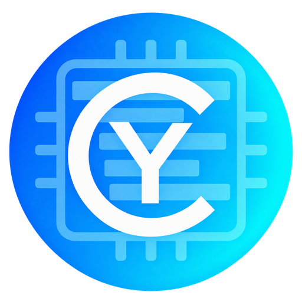
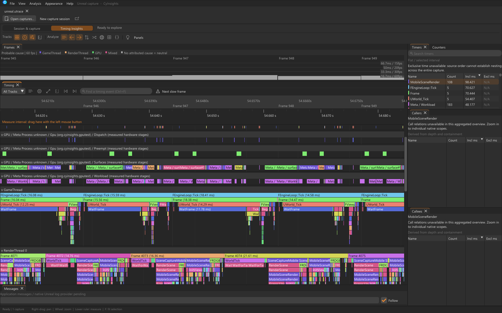
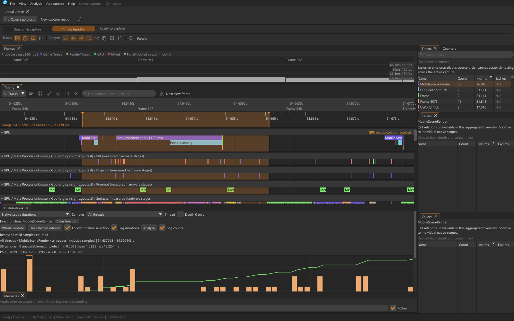
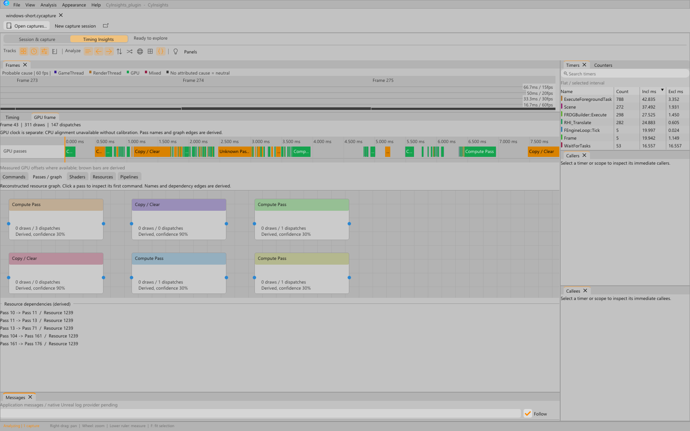

<table width="100%">
  <tr>
    <td width="300" align="left" valign="top">
      <a href="https://mrmybal.github.io/CyInsights/">Website</a><br>
      <a href="https://mrmybal.github.io/CyInsights/Documentation.html#/en/welcome">Manual</a><br>
      <a href="https://github.com/MrMybal/CyInsights">GitHub</a><br><br>
      <sub>README</sub><br>
      <a href="README.md">English</a> · <a href="README.fr.md">Français</a>
    </td>
    <td width="400" align="center" valign="middle">
      <a href="https://mrmybal.github.io/CyInsights/"></a>
    </td>
    <td width="300" align="right" valign="top">
      <p><sub>Application license</sub><br><a href="LICENSE"><strong>AGPL-3.0-or-later</strong></a></p>
      <p><sub>Version</sub><br><a href="Docs/Release-0.2.2-alpha.4.md"><strong>0.2.2-alpha.4</strong></a><br><strong>ALPHA</strong></p>
      <p><a href="https://github.com/MrMybal/CyInsights/releases/tag/v0.2.2-alpha.4"><strong>Download</strong></a><br><sub>Windows x64 · Quest arm64</sub></p>
    </td>
  </tr>
</table>

<h1 align="center">CyInsights</h1>

A native profiler for Unreal Engine developers and technical artists. Explore
CPU/GPU traces, frame statistics and recorded network, storage and memory activity
on one timeline. The standalone **CyInsightOVR** Quest app adds on-headset GPU
metrics and optional development-game profiling.

> **ALPHA · 0.2.2-alpha.4**
>
> An experimental release for testing and feedback; some providers and hardware
> paths remain incomplete. Read the [version notes and documented limitations](Docs/Release-0.2.2-alpha.4.md).

[](Docs/Images/cyinsights-timeline.png)

## About CyInsights

Open a `.utrace` or `.cycapture`, find a slow frame and measure an interval.
Follow nested CPU/GPU scopes across threads, double-click a function to filter
its exact name, or open its duration histogram from the context menu. Timers,
callers/callees, counters, tasks and A/B comparisons help narrow the investigation.
Several traces can stay open and move into separate windows.

[](Docs/Images/cyinsights-function-histogram.png)

The optional Unreal plugin records configurable frame statistics and supports
remote development captures. Native Unreal GPU scopes remain the first source
of detail. Supported Quest captures can include Meta hardware GPU stages;
the optional Windows collector adds commands, resources and GPU timestamps.
Measured values, reconstructed relationships and unavailable data stay distinct.

[](Docs/Images/cyinsights-gpu-passes.png)

CyInsightOVR runs on the headset and starts its own GPU service. It offers system
counter curves, configurable HUD graphs and values, and optional tile heatmaps
and draw/triangle counters for supported, prepared Development Vulkan targets.
Custom Vulkan overlays do not work universally on unmodified commercial games.

## Features

- **Continuous analysis:** synchronized frames, pan/zoom, a range-measurement ruler,
  interval statistics, duration distributions and independent A/B ranges.
- **Recorded activities:** Unreal counters, frame-stat snapshots, tasks,
  network packets, file operations, loading and memory samples when captured.
- **GPU evidence:** native scopes, optional Meta Quest hardware stages,
  tile/image replay and optional Windows command inspection.
- **Responsive workflow:** background preparation, persistent disk indexes,
  visible progress and cancellation; five native themes and two control densities.
- **Configurable capture:** basic defaults, optional stat groups and GPU detail;
  texture/buffer readbacks are off by default. Incoming traces are analyzed after stop.
- **Local analysis and AI integration:** native AI Inspector tools and a guided
  analysis method, plus an optional MCP/SDK companion with 39 supported operations.
  Control and recording permissions are separate and disabled initially.
- **Illustrated offline manual:** English and French, search, screenshots,
  diagrams and public API references. Use **Help > User manual** / **F1** on
  Windows or **Help** in CyInsightOVR. The same CyDoc reader is available online.
- **Stable-release updates:** Windows and Quest check GitHub for newer stable
  releases. Alpha builds are installed manually.

---

## Installation

### Windows desktop

1. [Download the Windows x64 ZIP](https://github.com/MrMybal/CyInsights/releases/download/v0.2.2-alpha.4/CyInsights-v0.2.2-alpha.4-Windows-x64.zip).
2. Extract the **whole archive**, then start `CyInsightsApp.exe`. Keep
   `Documentation/`, helper tools and license notices beside the application.
3. Use **Open capture**. For `.utrace` analysis, register your licensed Unreal
   installation in **Session > Native analyzer > Add engine** using its root folder.

Native timing/task/activity readers are prepared automatically in the background
and cached per engine. Preparation needs a compatible licensed UE 5.5–5.8 and the
Visual Studio C++/CMake tools; UE 5.8 needs MSVC 14.44. It builds our adapters,
not Unreal. The CSV timing bridge remains available if native preparation cannot
finish. No Unreal binaries are bundled. See the
[first-launch and packaging guide](Docs/GitHubRelease.md).

The published desktop build targets **Windows x64**. No Linux/macOS desktop
package is provided.

### Quest: CyInsightOVR

1. Install **one** Android arm64 APK:
   [Standard](https://github.com/MrMybal/CyInsights/releases/download/v0.2.2-alpha.4/CyInsights-v0.2.2-alpha.4-Quest-Standard-arm64.apk)
   or [Vulkan — experimental heatmap and draw counters](https://github.com/MrMybal/CyInsights/releases/download/v0.2.2-alpha.4/CyInsights-v0.2.2-alpha.4-Quest-Vulkan-arm64.apk).
2. Open **CyInsightOVR** from the Quest app library / **Unknown Sources**.
   Its GPU service starts from the app, including after a headset reboot.
3. Configure metrics and **Display & HUD**. Meta HUD controls and external Vulkan
   layers need a one-time developer authorization; the
   [complete Quest bundle](https://github.com/MrMybal/CyInsights/releases/download/v0.2.2-alpha.4/CyInsights-v0.2.2-alpha.4-Quest-arm64.zip)
   includes the optional installer and instructions.

Ordinary system-counter use does not need Unreal or a running PC helper.
Custom Vulkan counters and heatmaps require the Vulkan variant and a supported
debuggable target prepared for its layer. The
[Quest setup manual](https://mrmybal.github.io/CyInsights/Documentation.html#/en/quest-setup)
explains authorization, target reopening and firmware limits.

### Optional Unreal plugin and AI SDK

- [Unreal plugin sources](https://github.com/MrMybal/CyInsights/releases/download/v0.2.2-alpha.4/CyInsights-v0.2.2-alpha.4-Unreal-Plugins-Source.zip):
  copy `Plugins/CyInsights` into your project's `Plugins` directory and compile
  with your licensed engine. Sources target **UE 4.27 and 5.0–5.8**; consult the
  [compatibility matrix](Docs/UnrealCompatibility.md) for actual validation.
  Editor, Debug, DebugGame and Development clients are supported configurations;
  Shipping, Test and Server are excluded. Configure **Project Settings > Plugins > CyInsights**.
- [Standalone MCP / AI SDK](https://github.com/MrMybal/CyInsights/releases/download/v0.2.2-alpha.4/CyInsights-v0.2.2-alpha.4-AI-SDK.zip):
  use Python 3.11 x64 and `./AI/SetupRuntime.ps1` for the supplied offline wheels.
  Enable the bridge in **AI Inspector > Connection** when connecting an external
  client. Native AI Inspector tools work without Python, MCP or CyAiCodex.
  See the [SDK setup](AI/README.md).

Use the [versioned alpha release](https://github.com/MrMybal/CyInsights/releases/tag/v0.2.2-alpha.4)
for downloads and checksums; GitHub's **Latest** shortcut can select an older
non-prerelease.

## Source, build and required libraries

<details>
<summary>Build the Windows application and optional components</summary>

Use Windows x64, Visual Studio 2022 with the C++ desktop workload, CMake 3.21+,
Ninja, Python 3.11+ and Node.js 22+ with npm. The native application uses C++17.
Dependencies are pinned in the repository; no separate CyGPUInspector checkout
is needed.

```powershell
git clone https://github.com/MrMybal/CyInsights.git
cd CyInsights
python Tools/prepare_dependencies.py
npm --prefix .CyDocBuild ci --omit=peer --ignore-scripts
./build.cmd Release
```

Start `bin/Release/CyInsightsApp.exe`. Node.js/npm compile the manual during
builds; the installed reader needs neither. Preserve its complete
`Documentation/Documentation.html` and `Documentation/DocData/` export.

For CMake directly, use an x64 Visual Studio developer prompt:

```powershell
cmake -S . -B build/Local -G Ninja -DCMAKE_BUILD_TYPE=Release
cmake --build build/Local --target CyInsightsApp CyCaptureTool CyComponentTests
ctest --test-dir build/Local --output-on-failure
```

`./build.cmd Release --compile-only` compiles without linking/launching the UI;
`./build.cmd Release --tests-only` runs native component tests. `CYINSIGHTS_VS`
can select an installed Visual Studio directory. Optional Quest fake-runtime
tests need OpenXR headers through `UE_OPENXR_INCLUDE_DIR` or
`CYINSIGHTS_OPENXR_INCLUDE`.

CyUI 1.2.0 supplies Core, Canvas, Plots, Timeline, Nodes, Inspector, Images and
Diagnostics on desktop; Quest uses a smaller subset. Audio, Gallery, browser and
code-editor dependencies are excluded. See the [modular integration](Docs/CyUIMigration.md).

- **Quest APKs:** `python Quest/CyInsightOVR/build.py` uses Android SDK 34,
  build-tools 35.0.1, NDK 27.2 and Android Studio JBR. See the
  [Quest build and signing guide](Quest/CyInsightOVR/README.md#build-and-install).
- **Windows GPU collector:** optional, built separately with
  [Tools/WindowsCollector](Tools/WindowsCollector/README.md). The external
  add-on-capable ReShade runtime is configured separately. Our modules and
  collector do not launch the CyGPUInspector application.
- **Documentation:** `python Tools/build_docs.py`; see the
  [documentation build guide](.CyDocBuild/README.md).
- **Website:** `python Tools/build_site.py`; see [Site/README.md](Site/README.md).
- **Distribution:** see [release packaging](Docs/GitHubRelease.md) and
  [update behavior](Docs/Updates.md).

</details>

---

## License

**The CyInsights application uses [AGPL-3.0-or-later](LICENSE).** Our Unreal
plugin, native-reader adapters, Windows collector and shared in-process Core/API
have their own **MIT** component licenses. These do not replace the application's
license or Epic's terms. See the [licensing scope](Docs/Licensing.md).

### Libraries and external prerequisites

| Library · source | License · terms | Use / scope |
| --- | --- | --- |
| [Dear ImGui](https://github.com/ocornut/imgui) | [MIT and embedded notices](LICENCES/DearImGui/LICENSE.txt) | Native desktop and Quest interface; pinned 1.93 WIP snapshot. |
| [CyUI 1.2.0](https://github.com/MrMybal/CyUI) | [MIT — included text](LICENCES/CyUI-MIT.txt) · [pinned upstream license](https://github.com/MrMybal/CyUI/blob/ff023e646c6a3038b3dfbfd53f6d2b4a2f5955e3/LICENSE) | Selected native UI modules; upstream source access may require permission. |
| [CyDoc 0.1.0](https://github.com/MrMybal/CyDoc) | [MIT](LICENCES/CyDoc-MIT.txt) | Offline HTML reader and build-time compiler; only the image media module is included. |
| [CyGPUInspector components](https://github.com/MrMybal/CyGPUInspector) | [Analysis: AGPL-3.0-or-later](ThirdParty/CyGPUInspector/LICENSE) · [Core: MIT](ThirdParty/CyGPUInspector/CyGPUInspectorCore/LICENSE) | Vendored analysis/session and shared IPC/format code; no separate application required. |
| [ReShade SDK](https://github.com/crosire/reshade) | [BSD-3-Clause](LICENCES/ReShade-SDK/LICENSE.md) · [overlay ImGui: MIT](LICENCES/DearImGui-ReShade/LICENSE.txt) | Headers for the optional Windows collector. The external runtime DLL is not included; its [separate notices](LICENCES/ReShade/LICENSE-ReShade.txt) apply. |
| [CyToolsCore 0.10.1](https://github.com/MrMybal/CyToolsCore) | [MIT](LICENCES/CyToolsCore-MIT.txt) | Optional Python SDK/MCP companion. |
| [MCP Python SDK 1.30.0](https://github.com/modelcontextprotocol/python-sdk) | [MIT](LICENCES/AI/mcp-1.30.0-py3-none-any/LICENSE) · [dependency notices](LICENCES/AI/) | Optional external AI connection; locked offline wheels also include development/test dependencies. |
| [CPython](https://github.com/python/cpython) | [PSF and component terms](LICENCES/AI/Python-3.11-License.txt) | External build interpreter and optional Python 3.11 x64 companion runtime. |
| [OpenXR](https://github.com/KhronosGroup/OpenXR-SDK) | [Apache-2.0](LICENCES/OpenXR.txt) | Quest/native integration prerequisite; engine/SDK headers are supplied separately. |
| [Unreal Engine](https://www.unrealengine.com/) | [Epic terms and integration scope](Docs/Licensing.md#unreal-engine) | External licensed plugin/native-reader prerequisite; no Epic source, libraries or binaries are bundled. |

The manual's compiler uses marked, PrismJS and esbuild at build time, with their
notices retained in the exported documentation. Build tools and platform SDKs
keep their respective terms. This table indexes the main components; retain the
[complete component inventory](THIRD-PARTY-CyGPUInspector.md), `LICENCES/`, the
reader's dependency notices and the corresponding source/build scripts supplied
with distributions. No affiliation with Epic, Meta or ReShade is implied.

## References and links

- [English manual](https://mrmybal.github.io/CyInsights/Documentation.html#/en/welcome) · [Manuel en français](https://mrmybal.github.io/CyInsights/Documentation.html#/fr/welcome).
- [Product website](https://mrmybal.github.io/CyInsights/) · [Présentation en français](https://mrmybal.github.io/CyInsights/?lang=fr).
- [Source repository](https://github.com/MrMybal/CyInsights) · [Releases](https://github.com/MrMybal/CyInsights/releases) · [Issue tracker](https://github.com/MrMybal/CyInsights/issues).
- [Quest app](Quest/CyInsightOVR/README.md) · [Unreal plugin](Plugins/CyInsights/README.md) · [MCP/SDK](AI/README.md).
