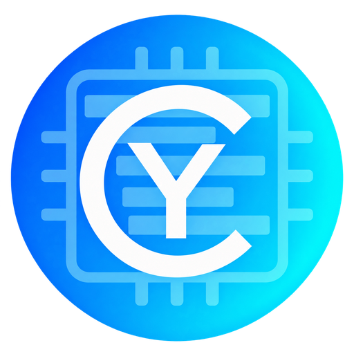

# CyInsights

Native interface navigation, query preparation and performance measurements are documented in [InterfacePerformance](Docs/InterfacePerformance.md).

Native C++ / Dear ImGui profiler for Unreal Engine traces, with an Insights-style
continuous CPU/GPU timeline and optional extra GPU capture data. The interface
is written for CyInsights; it does not reuse the CyGPUInspector standalone UI.



## Current capabilities

- Open `.utrace` and versioned `.cycapture` archives. Preserve the original trace.
- Continuous tracks, synchronized frame overview, pan/zoom and range selection.
- Timers, callers/callees, counters, task analysis, distributions and A/B comparison.
- Network packets, Unreal file operations, asset loading and memory samples on the same timeline.
- Double-click exact function filtering and right-click interval histograms.
- Background workers, persistent disk indexes and visible loading/cancellation.
- Frame diagnostics with recognized wait time and measured/derived distinctions.
- Native AI Inspector and 17 CyToolsCore/MCP operations for compact analysis,
  findings, timeline control and permission-gated remote capture.
- Development capture over a local network by target IPv4, including Quest metrics.
- Windows ReShade collector for commands, pipelines, shaders, resources and GPU timestamps.

**This is a development build, not full Unreal Insights feature parity.** Native
timings use an optional matching installed-engine binary reader; without it,
the Epic Unreal Insights CSV bridge remains available. Counter values still use
the export bridge. See [direct timing reading](Docs/NativeTiming.md).
Original traces are read-only; there is no arbitrary
file-size/event-count rejection. Optional TaskTrace decoding uses a local adapter.
Native activity providers use an optional installed-engine reader; memory callstack exploration, native log UI and other Insights providers remain incomplete.
Incoming traces are analyzed after recording stops. The application targets
Windows; it can analyze Android captures on the PC.

See [capability coverage](Docs/CapabilityCoverage.md),
[interface behavior](Docs/InterfaceRevision.md), [task/distribution analysis](Docs/TraceAnalysis.md),
[performance](Docs/TimelineFunctionAnalysis.md) and [AI integration](Docs/AiIntegration.md).

## Build the application

For GitHub release packages and local native-reader installation, see
[release instructions](Docs/GitHubRelease.md).

Requirements: Windows x64, Visual Studio 2022 C++ desktop workload with CMake/Ninja,
and Python 3. Sources required by the build are versioned in this repository.
No separate CyGPUInspector checkout is needed. From the repository root:

```powershell
python Tools/prepare_dependencies.py
./build.cmd Release
```

The executable is produced in `bin/Release/CyInsightsApp.exe`. Binaries, native
captures, intermediate indexes, caches and the local Unreal test project are not
committed. `CYINSIGHTS_VS` can select an installed Visual Studio directory.
For CMake directly, use an x64 Visual Studio developer prompt:

```powershell
cmake -S . -B build/Local -G Ninja -DCMAKE_BUILD_TYPE=Release
cmake --build build/Local --target CyInsightsApp CyCaptureTool CyComponentTests
ctest --test-dir build/Local --output-on-failure
```

Compile without launching/linking the UI with `./build.cmd Release --compile-only`;
run native component tests with `./build.cmd Release --tests-only`. Optional Quest
fake-runtime tests need the OpenXR headers: set `UE_OPENXR_INCLUDE_DIR` or the
CMake `CYINSIGHTS_OPENXR_INCLUDE` path. No engine headers are bundled.
The approved logo and derived embedded icon/PNG are included; Pillow is needed
only to regenerate those assets with `Tools/prepare_branding.py`.

## Open a trace

Start the application, use **Open capture**, and select a `.utrace` or `.cycapture`.
In **Session > Select UnrealInsights.exe**, select the matching licensed engine's
Unreal Insights executable. Decoding and indexing show progress; previously
indexed files reuse their disk cache. Select an interval to constrain statistics,
histograms and AI findings. Open **Activities** for network, storage, loading and
memory tracks. See [capture and timeline semantics](Docs/NativeActivities.md).

At launch the app detects installed Unreal analyzers and automatically prepares
the native timing/task/activity readers in the background, with visible progress,
log and cancellation. Results are cached per engine installation for future launches.
This first-time preparation needs a licensed installed UE 5.5–5.8 and Visual Studio
C++/CMake tools (MSVC 14.44 for UE 5.8); it does not rebuild Unreal. No manual script
is required. If dependencies are missing or preparation is cancelled, the CSV
timing bridge remains available. See [first launch](Docs/GitHubRelease.md).

Choose your installed analyzer in **Session > Select UnrealInsights.exe**, or
set the local `CYINSIGHTS_UNREAL_INSIGHTS` environment variable to its executable
path before launching. Matching versions are searched beside that installation.

The existing local development release `Release-20261010.1` predates this licensing
adaptation and is not a GitHub release. Historical security/build evidence and
limitations remain in [testing notes](Docs/TestingRelease.md) and
[security review](Docs/SecurityReview.md). This repository does not certify or
relicense historical binaries.

## Unreal plugin and GPU collection

Copy `Plugins/CyInsights` into your own Unreal project's Plugins directory and
enable it. Modules permit Editor and Debug/DebugGame/Development clients;
Shipping, Test and Server are excluded. The plugin sources target UE 4.27 and
5.0–5.8. See the [compatibility and validation matrix](Docs/UnrealCompatibility.md)
for tested versions and older-engine limitations. Only project/plugin modules
are compiled; the engine is not modified.

For Windows GPU detail, also install `Plugins/CyGPUInspector`, build the separately
licensed [Windows collector](Tools/WindowsCollector/README.md), and configure a
separately installed add-on-capable ReShade runtime. This repository includes
collector source, not ReShade runtime DLLs or old copied add-ons.

Quest/Android collects Meta OpenXR performance metrics into the same native
trace, without launching a separate headset monitor. Their sampling interval
and observed game frame are not unique GPU execution-frame identities. A Vulkan
command collector is not implemented. ReShade is Windows-specific; console and
other collectors are extension points, not available backends.

In **Session**, enter the target IPv4 and use **Start remote trace** / **Stop remote
trace** / **Open received capture**. The development plugin handles control and
streams to the PC; the PC packages after stop. See [remote capture](Docs/RemoteCapture.md),
[archive/synchronization format](Docs/CaptureFormat.md) and [platform coverage](Docs/CapabilityCoverage.md).
On a development network, restrict access to the capture command port to trusted
hosts; this service is not an Internet-facing endpoint.

## Optional AI/MCP companion

Python 3.11 x64 is required for the provided offline Windows wheels:

```powershell
./AI/SetupRuntime.ps1
```

Open **AI Inspector > Connection**, enable the local bridge and copy the MCP
configuration for your AI client. Application control and recording permissions
are separate and disabled initially. The companion has no embedded chat model
or model weights. `AI/runtime` is created locally and is not tracked. See
[the companion README](AI/README.md); package a newly compiled application with
`Tools/package_ai.py` to put the companion beside its executable.

## Licenses

The application and reused GPU Session/Analysis are **AGPL-3.0-or-later**.
Our Unreal plugins, optional native task adapter, Windows collector and shared
in-process Core/API copy are **MIT**. Third-party licenses are preserved.
This scoped adaptation is authorized by owner Cyberalien (MrMybal); it does
not change Epic's license or the original CyGPUInspector repository.

Read [licensing and distribution scope](Docs/Licensing.md), [third-party inventory](THIRD-PARTY-CyGPUInspector.md)
and the component LICENSE files. No Epic source, libraries or binaries are
distributed. A future public distribution of Unreal-linked tools must use the
appropriate Epic channel where the EULA requires it. AGPL binary distribution
requires corresponding sources. The repository is currently private.
